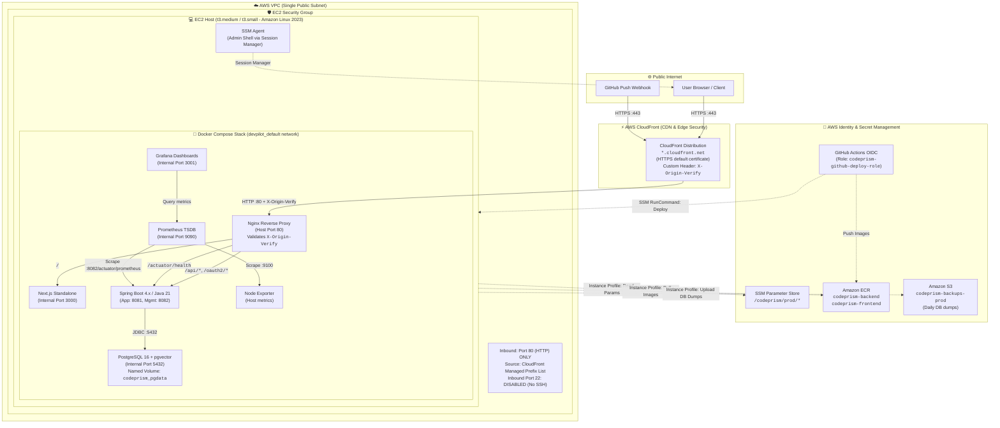

# Phase 03: AWS Foundation Planning & Architecture Design

> **Audience:** Project Owner & Engineering Team  
> **Status:** Planning Documentation Only (Zero AWS CLI creation commands executed)  
> **Budget Target:** $100–$200 in AWS Credits for ~6 Months  
> **Reference Topology:** Single `t3.medium` / `t3.small` EC2 instance running Docker Compose behind default CloudFront

---

## 1. System Architecture

The CodePrism production environment is engineered around a **single-origin, single-instance architecture** that minimizes infrastructure overhead while providing production-grade security, automated CI/CD deployments, and full observability.



---

## 2. Network & Security Group Plan

### 2.1 Zero-Open-SSH Principle
- **No Inbound Port 22:** Port 22 (SSH) is completely closed in the Security Group.
- **Access via AWS Systems Manager (SSM) Session Manager:** Developers and operators connect securely via IAM credentials and the AWS Console or AWS CLI (`aws ssm start-session`), which tunnels encrypted console sessions over outbound HTTPS (443) via the pre-installed SSM Agent.
- **Benefits:** No SSH keys to manage, rotate, or accidentally leak; zero attack surface from public SSH scanners.

### 2.2 Security Group Rules (`sg-codeprism-prod`)

| Direction | Type | Protocol | Port Range | Source / Destination | Purpose & Rationale |
|---|---|---|---|---|---|
| **Inbound** | Custom HTTP | TCP | `80` | `com.amazonaws.global.cloudfront.origin-facing` (AWS Managed Prefix List) | Allows HTTP traffic **only** from AWS CloudFront edge nodes. In the AWS Console or Terraform, select the managed prefix list by name `com.amazonaws.global.cloudfront.origin-facing` (do **not** hardcode the prefix list ID, as the ID differs per AWS region). Direct browser requests attempting to bypass CloudFront are dropped at the VPC boundary. |
| **Inbound** | SSH | TCP | `22` | *None (Rule Deleted)* | Fully blocked. Administrative shell access uses AWS SSM Session Manager. |
| **Outbound** | All Traffic | Any | All | `0.0.0.0/0` | Outbound access for OS security patches, Docker image pulls from ECR, GitHub API calls, and Gemini LLM API calls. |

> [!TIP]
> **Origin Verification Header (`X-Origin-Verify`):**  
> In addition to the security group restriction, CloudFront injects a secret custom header (e.g., `X-Origin-Verify: <secret>`) on every request forwarded to the EC2 origin. Nginx validates this header and rejects any request missing it with `HTTP 403 Forbidden`. This provides defense-in-depth against unauthorized traffic.

> [!IMPORTANT]
> **GitHub Webhook URL Configuration:**  
> When CloudFront is created, the repository webhook in **GitHub Settings $\rightarrow$ Webhooks** must be updated to:  
> `https://<distribution-id>.cloudfront.net/api/webhooks/github`  
> (Content type: `application/json`, Secret: `/codeprism/prod/GITHUB_WEBHOOK_SECRET`).  
> Likewise, in the GitHub OAuth application settings, update the Homepage URL to `https://<distribution-id>.cloudfront.net` and Authorization Callback URL to `https://<distribution-id>.cloudfront.net/login/oauth2/code/github`.

---

## 3. SSM Parameter Store Inventory

All application secrets are externalized into **AWS Systems Manager (SSM) Parameter Store** under the `/codeprism/prod/` hierarchy. Secrets are stored as encrypted strings (`SecureString`) using the default AWS KMS key (`alias/aws/ssm`), incurring zero extra key fees.

| Parameter Store Name | Type | Purpose | How Used by Backend / Stack |
|---|---|---|---|
| `/codeprism/prod/DB_PASSWORD` | `SecureString` | PostgreSQL master password | Passed as `DB_PASSWORD` / `POSTGRES_PASSWORD` |
| `/codeprism/prod/DB_USERNAME` | `String` | PostgreSQL master username | `postgres` |
| `/codeprism/prod/TOKEN_ENCRYPTOR_PASSWORD` | `SecureString` | 32-byte secret for encrypting stored GitHub OAuth tokens | Passed to `app.token-encryptor-password` |
| `/codeprism/prod/TOKEN_ENCRYPTOR_SALT` | `SecureString` | 16-hex character salt for token encryption | Passed to `app.token-encryptor-salt` |
| `/codeprism/prod/GITHUB_CLIENT_ID` | `String` | Production GitHub OAuth Application Client ID | Spring Security OAuth2 login |
| `/codeprism/prod/GITHUB_CLIENT_SECRET` | `SecureString` | Production GitHub OAuth Application Client Secret | Spring Security OAuth2 token exchange |
| `/codeprism/prod/GITHUB_WEBHOOK_SECRET` | `SecureString` | Secret key for verifying HMAC-SHA256 push event signatures | Verified in `WebhookController` |
| `/codeprism/prod/GEMINI_API_KEY` | `SecureString` | Google Gemini API key for embeddings & LLM chat | Injected into `spring.ai.openai.api-key` |
| `/codeprism/prod/ORIGIN_VERIFY_SECRET` | `SecureString` | Shared secret header validated by Nginx | Matched against `X-Origin-Verify` header |
| `/codeprism/prod/GRAFANA_ADMIN_PASSWORD` | `SecureString` | Initial admin password for Grafana UI | Injected into Grafana container environment |
| `/codeprism/prod/JWT_SECRET` | `SecureString` | Reserved for future stateless token authentication | Application token issuance |

*Note: All secret values remain empty placeholders in documentation and templates as required by Rule 2.*

---

## 4. IAM Architecture & Exact Policy JSONs

### 4.1 EC2 Instance Profile Role (`codeprism-ec2-role`)

This role is attached directly to the EC2 virtual machine. It grants the instance permissions to communicate with SSM, pull container images from ECR, retrieve its runtime secrets from Parameter Store, and upload daily database backups to Amazon S3.

#### Trust Policy (EC2 Service Principal):
```json
{
  "Version": "2012-10-17",
  "Statement": [
    {
      "Effect": "Allow",
      "Principal": {
        "Service": "ec2.amazonaws.com"
      },
      "Action": "sts:AssumeRole"
    }
  ]
}
```

#### Managed Policy Attached:
- `arn:aws:iam::aws:policy/AmazonSSMManagedInstanceCore` (enables SSM Session Manager console access without open SSH ports).

#### Inline Permissions Policy (`codeprism-ec2-workload-policy`):
```json
{
  "Version": "2012-10-17",
  "Statement": [
    {
      "Sid": "ReadParameterStoreSecrets",
      "Effect": "Allow",
      "Action": [
        "ssm:GetParameter",
        "ssm:GetParameters",
        "ssm:GetParametersByPath"
      ],
      "Resource": "arn:aws:ssm:*:*:parameter/codeprism/prod/*"
    },
    {
      "Sid": "DecryptKmsSecrets",
      "Effect": "Allow",
      "Action": [
        "kms:Decrypt"
      ],
      "Resource": "*",
      "Condition": {
        "StringEquals": {
          "kms:CallerAccount": "${aws:PrincipalAccount}"
        }
      }
    },
    {
      "Sid": "EcrContainerPullAccess",
      "Effect": "Allow",
      "Action": [
        "ecr:GetAuthorizationToken",
        "ecr:BatchCheckLayerAvailability",
        "ecr:GetDownloadUrlForLayer",
        "ecr:BatchGetImage"
      ],
      "Resource": "*"
    },
    {
      "Sid": "S3DatabaseBackupAndRestoreAccess",
      "Effect": "Allow",
      "Action": [
        "s3:PutObject",
        "s3:GetObject",
        "s3:AbortMultipartUpload"
      ],
      "Resource": "arn:aws:s3:::codeprism-backups-prod/*"
    },
    {
      "Sid": "S3BackupBucketListAccess",
      "Effect": "Allow",
      "Action": [
        "s3:ListBucket"
      ],
      "Resource": "arn:aws:s3:::codeprism-backups-prod"
    }
  ]
}
```
*Note: `s3:GetObject` and `s3:ListBucket` are explicitly included so that disaster recovery database restore drills can be executed directly on the EC2 host.*

---

### 4.2 GitHub Actions OIDC Deploy Role (`codeprism-github-deploy-role`)

This role allows GitHub Actions workflows to authenticate to AWS securely **without storing any long-lived AWS Access Keys or Secrets in GitHub repository settings**. It uses OpenID Connect (OIDC) with short-lived tokens.

#### Important OIDC Subject (`sub`) Format Distinction:
- **When a job uses a GitHub Environment (`environment: production`):**  
  GitHub sets the OIDC subject claim (`sub`) to:  
  `repo:OWNER/REPO:environment:NAME` (e.g. `repo:Vishal0021-hub/CodePrism:environment:production`).
- **When a job does NOT use an environment:**  
  GitHub sets the OIDC subject claim (`sub`) to the Git reference:  
  `repo:OWNER/REPO:ref:refs/heads/BRANCH` (e.g. `repo:Vishal0021-hub/CodePrism:ref:refs/heads/deploy/aws`).

The trust policy below allows both: it authorizes the `production` environment subject, while also retaining the `deploy/aws` branch subject for workflows where environments are not enabled.

#### Trust Policy (Restricted strictly to the `Vishal0021-hub/CodePrism` repository):
```json
{
  "Version": "2012-10-17",
  "Statement": [
    {
      "Effect": "Allow",
      "Principal": {
        "Federated": "arn:aws:iam::<ACCOUNT_ID>:oidc-provider/token.actions.githubusercontent.com"
      },
      "Action": "sts:AssumeRoleWithWebIdentity",
      "Condition": {
        "StringEquals": {
          "token.actions.githubusercontent.com:aud": "sts.amazonaws.com"
        },
        "StringLike": {
          "token.actions.githubusercontent.com:sub": [
            "repo:Vishal0021-hub/CodePrism:environment:production",
            "repo:Vishal0021-hub/CodePrism:ref:refs/heads/deploy/aws"
          ]
        }
      }
    }
  ]
}
```

#### Inline Permissions Policy (`codeprism-github-deploy-permissions`):
```json
{
  "Version": "2012-10-17",
  "Statement": [
    {
      "Sid": "EcrAuthentication",
      "Effect": "Allow",
      "Action": [
        "ecr:GetAuthorizationToken"
      ],
      "Resource": "*"
    },
    {
      "Sid": "EcrImagePushAccess",
      "Effect": "Allow",
      "Action": [
        "ecr:CompleteLayerUpload",
        "ecr:UploadLayerPart",
        "ecr:InitiateLayerUpload",
        "ecr:BatchCheckLayerAvailability",
        "ecr:PutImage"
      ],
      "Resource": [
        "arn:aws:ecr:*:*:repository/codeprism-backend",
        "arn:aws:ecr:*:*:repository/codeprism-frontend"
      ]
    },
    {
      "Sid": "TriggerRemoteEc2DeploymentViaSsm",
      "Effect": "Allow",
      "Action": [
        "ssm:SendCommand",
        "ssm:GetCommandInvocation"
      ],
      "Resource": [
        "arn:aws:ec2:*:*:instance/*",
        "arn:aws:ssm:*:*:document/AWS-RunShellScript"
      ]
    }
  ]
}
```

---

## 5. Month-by-Month Credit Burn & Cost Analysis

The cost projection includes all charges: EC2 compute, the mandatory public IPv4 address fee ($0.005/hour), 30 GB gp3 EBS root volume, EBS snapshots, S3 database backups, and Amazon ECR image storage.

### 5.1 Comprehensive Pricing Assumptions (US East - N. Virginia / Ohio)
- **Hours in a month:** 730 hours (average).
- **`t3.medium` Compute:** $0.0416 / hour.
- **`t3.small` Compute:** $0.0208 / hour.
- **In-Use Public IPv4 Address:** $0.005 / hour = **$3.65 / month** (AWS charges for public IPv4 addresses continuously 24/7, even when the underlying EC2 instance is stopped).
- **EBS gp3 Root Volume (30 GB):** $0.08 / GB-month = $2.40 / month (persists while running or stopped).
- **EBS Snapshots (Weekly differential, ~10 GB):** $0.05 / GB-month = $0.50 / month.
- **Amazon S3 Backups (PostgreSQL dumps, ~5 GB):** $0.023 / GB-month = $0.12 / month.
- **Amazon ECR Storage (2 repos, ~3 GB total):** First 500 MB free, 2.5 GB @ $0.10/GB = $0.25 / month.
- **CloudFront:** Default `*.cloudfront.net` domain; Free Tier covers 1 TB egress and 10M requests ($0.00).
- **EC2 to CloudFront Egress:** $0.00 (AWS Free Data Transfer Out to CloudFront).
- **SSM Parameter Store & Session Manager:** Standard tier is 100% free ($0.00).

---

### 5.2 Monthly Cost Breakdown Table

| Cost Component | `t3.medium` Always-On (24/7) | `t3.medium` Stopped when Idle (~8h/day) | `t3.small` Always-On (24/7) | `t3.small` Stopped when Idle (~8h/day) |
|---|---|---|---|---|
| **EC2 Compute** | $30.37 (730 hrs) | $8.32 (200 hrs) | $15.18 (730 hrs) | $4.16 (200 hrs) |
| **Public IPv4 Address** ($0.005/hr) | $3.65 (730 hrs) | $3.65 (billed 24/7) | $3.65 (730 hrs) | $3.65 (billed 24/7) |
| **EBS Storage** (30 GB gp3) | $2.40 | $2.40 | $2.40 | $2.40 |
| **EBS Snapshots** (~10 GB) | $0.50 | $0.50 | $0.50 | $0.50 |
| **S3 Database Backups** (~5 GB) | $0.12 | $0.12 | $0.12 | $0.12 |
| **ECR Container Registry** (~3 GB) | $0.25 | $0.25 | $0.25 | $0.25 |
| **CloudFront & Data Transfer** | $0.00 (Free Tier) | $0.00 (Free Tier) | $0.00 (Free Tier) | $0.00 (Free Tier) |
| **Total Monthly Cost** | **$37.29 / mo** | **$15.24 / mo** | **$22.10 / mo** | **$11.08 / mo** |
| **Daily Cost Rate** | ~$1.24 / day | ~$0.51 / day | ~$0.74 / day | ~$0.37 / day |

---

### 5.3 6-Month Credit Burn Forecast

| Operating Profile | Month 1 | Month 2 | Month 3 | Month 4 | Month 5 | Month 6 | **Cumulative 6-Mo Burn** | Budget Assessment ($100–$200 Credits) |
|---|---|---|---|---|---|---|---|---|
| **`t3.medium` Always-On** | $37.29 | $37.29 | $37.29 | $37.29 | $37.29 | $37.29 | **$223.74** | ⚠️ Slightly exceeds $200 credit budget if left 24/7 on medium |
| **`t3.medium` Stopped when Idle** | $15.24 | $15.24 | $15.24 | $15.24 | $15.24 | $15.24 | **$91.44** | ✅ **Safely within $100 budget** with ~$8.56–$108.56 reserve |
| **`t3.small` Always-On** | $22.10 | $22.10 | $22.10 | $22.10 | $22.10 | $22.10 | **$132.60** | ✅ **Fits within $150–$200 credit range** |
| **`t3.small` Stopped when Idle** | $11.08 | $11.08 | $11.08 | $11.08 | $11.08 | $11.08 | **$66.48** | 🌟 **Maximum savings:** Preserves credits for up to 18–36 months |

> [!IMPORTANT]
> **Recommended Strategy:**  
> Launch on **`t3.medium`** initially to ensure smooth application indexing and verification. Profile real CPU and memory usage using `docker stats`. If total memory utilization remains consistently below 1.5 GiB, downsize to **`t3.small`** to lock in the **~$22.10/month** always-on rate.

---

## 6. Plain-Language AWS Glossary

For developers and project owners new to AWS, here is what each service does:

1. **Amazon EC2 (Elastic Compute Cloud):**  
   *What it is:* A virtual server in the cloud where your application lives and runs.  
   *Why we use it:* It hosts our single Docker Compose stack running all 7 containers (`nginx`, `backend`, `frontend`, `postgres`, `prometheus`, `grafana`, `node-exporter`).

2. **Amazon CloudFront:**  
   *What it is:* A fast, global Content Delivery Network (CDN) operated by AWS.  
   *Why we use it:* It sits in front of the EC2 instance, providing a free, secure HTTPS web address (`https://<distribution-id>.cloudfront.net`) without needing to purchase a custom domain or configure SSL certificates.

3. **Amazon EBS (Elastic Block Store):**  
   *What it is:* A persistent virtual hard disk attached to the EC2 server (specifically using high-performance `gp3` solid-state storage).  
   *Why we use it:* It stores the operating system, Docker images, and your PostgreSQL vector database volume (`codeprism_pgdata`) so your data survives server restarts.

4. **Security Group:**  
   *What it is:* A virtual firewall controlling what network traffic is allowed to enter or leave your server.  
   *Why we use it:* We lock it down so **only** CloudFront can reach port 80. Hackers and internet scanners cannot connect to your server directly.

5. **AWS Systems Manager (SSM) Session Manager:**  
   *What it is:* A secure browser- and CLI-based terminal console for logging into your EC2 server.  
   *Why we use it:* Replaces traditional SSH (Port 22). Eliminates the risk of leaked SSH key pairs and keeps port 22 closed to the outside world.

6. **SSM Parameter Store:**  
   *What it is:* A secure digital vault for storing configuration keys and encrypted secrets.  
   *Why we use it:* Keeps passwords, OAuth credentials, and Gemini API keys out of Git repositories and Docker images.

7. **Amazon ECR (Elastic Container Registry):**  
   *What it is:* A private Docker container image registry hosted in AWS (like a private Docker Hub).  
   *Why we use it:* Stores the production Docker images built by GitHub Actions so the EC2 server can pull and run them.

8. **Amazon S3 (Simple Storage Service):**  
   *What it is:* Highly durable object file storage in the cloud.  
   *Why we use it:* Stores automated daily database dump archives (`.sql.gz`) as disaster recovery backups.

9. **GitHub Actions OIDC (OpenID Connect):**  
   *What it is:* A modern, keyless authentication standard allowing GitHub Actions workflows to communicate with AWS.  
   *Why we use it:* Allows automated continuous deployment without saving sensitive, permanent AWS secret keys in GitHub settings.

10. **Amazon CloudWatch:**  
    *What it is:* AWS's central monitoring and alerting service.  
    *Why we use it:* Tracks server health and sends emergency email billing alerts if credit consumption exceeds your budget threshold.
